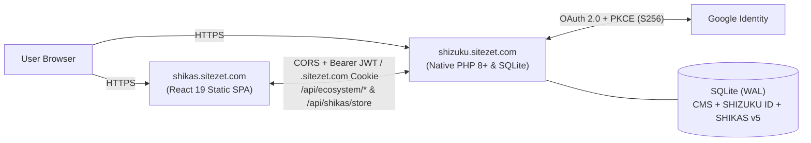

<div align="center">

# shizuku (雫) — Native PHP Edition

**Minimalist personal digital hub, portfolio CMS, and central `SHIZUKU ID` identity & database server for the SHIZUKU ecosystem.**

[](https://shizuku.sitezet.com)
[](https://shikas.sitezet.com)
[](#tech-stack)
[](#tech-stack)
[](#why-native-php)

</div>

---

## Live Ecosystem

| App | Role | Live URL | Repository |
| :--- | :--- | :--- | :--- |
| **SHIZUKU (雫)** | Personal Hub, Portfolio CMS & Central `SHIZUKU ID` Auth/DB Server | **[shizuku.sitezet.com](https://shizuku.sitezet.com)** | [`farhansatrian/shizuku-php`](https://github.com/farhansatrian/shizuku-php) *(active prod)* |
| **SHIKAS (雫)** | Personal Cashflow, Multi-Pocket & Payday Cycle Tracker | **[shikas.sitezet.com](https://shikas.sitezet.com)** | [`farhansatrian/shikas`](https://github.com/farhansatrian/shikas) |
| **SHIZUKU (Next.js)** | Docker / VPS Archive Edition (identical UI/UX & API contract) | — | [`farhansatrian/shizuku`](https://github.com/farhansatrian/shizuku) |

---

## Architecture

`shizuku-php` acts as both a **personal portfolio/CMS** and the **central identity & private cloud storage hub** for companion apps across `*.sitezet.com`:



---

## Key Features

### Public Experience & Editorial UI
- **Minimalist Japanese Pastel Aesthetic** — Full-bleed watercolor backdrop, subtle drifting raindrop layer, clean editorial framing, and responsive mobile drawer across `360px` to desktop.
- **5 Dedicated Routes**:
  - `/` **Home** — Gallery showcase with first-visit splash reveal.
  - `/work` **Ecosystem Hub** — App launcher (`SHIZUKU`, `SHIKAS`, `SHIKOST`, and upcoming apps) + active `SHIZUKU ID` status card.
  - `/portfolio` **CV & Records** — Education, Work, Parent-Grouped Organization timeline, and Certificate gallery with modal lightbox.
  - `/about` **Profile** — Personal narrative, roles, focus areas, and contact links.
  - `/account` **SHIZUKU ID** — Sign up, sign in, **Sign in with Google**, live synced entry counter, and quick launch into `SHIKAS`.
- **Instant Bilingual Switch (`EN | ID`)** — Seamless English/Indonesian switching across UI chrome and database-managed CMS fields.

### 5-Tab Admin Studio (`/admin`)
- **Profile** — Edit bilingual name, bio, tagline, social links, and visual assets.
- **Work** — Add, edit, reorder, toggle visibility, and manage ecosystem app cards.
- **Portfolio** — Full CRUD for Education, Work, and Organization records (supports parent-organization grouping chips).
- **Certificates** — Upload images (magic-byte validated), edit metadata, preview in lightbox, and reorder entries.
- **Security** — Manage admin account email/password securely with `password_hash()` and CSRF same-origin enforcement.

### Central `SHIZUKU ID` SSO & `SHIKAS` v5 Cloud Sync
- **Dual Auth Transport** — Signed **HS256 JWT** (`RFC 7519`) delivered via `HttpOnly` cookie (optional cross-subdomain `.sitezet.com`) **and** `Authorization: Bearer <token>` header for cross-origin companion apps.
- **Sign in with Google (OAuth 2.0 + PKCE S256)** — Stateless encrypted state cookie, strict origin allowlist against open redirects, and `#shizuku_token=<jwt>` handoff for companion SPAs.
- **Strict Per-User Isolation** — Every companion table uses composite primary keys `(userId, id)` with `ON DELETE CASCADE`; users can only read/write their own rows.

---

## Why Native PHP?

Designed specifically to run **fast and reliably on standard cPanel / Apache shared hosting** with zero infrastructure overhead:

| Metric | `shizuku-php` |
| :--- | :--- |
| **Runtime RAM** | `~10–25 MB` per request, **`0 MB` idle** |
| **External Dependencies** | **Zero** (no Composer, no Node.js runtime, no MySQL server required) |
| **Database** | Embedded single-file **SQLite** with automatic schema migration & seeding |
| **CSS Footprint** | Standalone precompiled `public/css/shizuku.css` (`~11 KB` gzipped) |
| **Hosting Compatibility** | Any PHP **8.1+** host with standard `pdo_sqlite`, `curl`, `openssl`, `fileinfo`, `mbstring` |

---

## Ecosystem API Contract

| Endpoint | Method | Auth | Purpose |
| :--- | :--- | :--- | :--- |
| `/api/health` | `GET` | Public | Health check & runtime metadata |
| `/api/ecosystem/register` | `POST` | Public (CORS) | Create `SHIZUKU ID` → `201 { user, token }` |
| `/api/ecosystem/login` | `POST` | Public (CORS) | Sign in with email & password → `200 { user, token }` |
| `/api/ecosystem/logout` | `POST` | Public (CORS) | Clear session cookie → `200 { ok: true }` |
| `/api/ecosystem/me` | `GET` | Cookie / Bearer | Return active `{ user }` or `{ user: null }` |
| `/api/ecosystem/google` | `GET` | Public | Start Google OAuth 2.0 + PKCE flow (`?redirect=...`) |
| `/api/ecosystem/google/callback` | `GET` | OAuth State | Complete Google SSO & issue session cookie / `#shizuku_token` |
| `/api/shikas/store` | `GET` / `PUT` | **Required** | Per-user `SHIKAS` v5 state (`accounts[]`, `cycleStartDay`, `transactions[]` with `income \| expense \| transfer` & `feeIdr`) |

---

## Project Structure

```text
shizuku-php/
├── index.php                # Single front-controller & HTTP router
├── .htaccess                # Apache rewrites, Bearer passthrough & security rules
├── .env.example             # Environment configuration template
├── data/
│   ├── shizuku.db           # Auto-created SQLite database (gitignored)
│   └── uploads/             # Admin-uploaded media assets (gitignored)
├── public/
│   ├── css/shizuku.css      # Precompiled standalone stylesheet
│   ├── js/                  # Public UI & Admin Studio vanilla JS
│   └── assets/              # Static artwork & fallback images
└── src/
    ├── config.php           # .env loader & public base URL resolver
    ├── db.php               # SQLite PDO connection, schema migrations & seed
    ├── jwt.php              # Zero-dependency RFC 7519 HS256 JWT implementation
    ├── auth.php             # Admin & SHIZUKU ID session guards + CSRF checks
    ├── google_oauth.php     # Google OAuth 2.0 + PKCE S256 SSO handler
    ├── http.php             # CORS, Bearer extraction, cookies & JSON helpers
    ├── uploads.php          # Safe magic-byte image upload & serving
    ├── api/                 # REST route handlers (ecosystem, shikas, admin, auth)
    └── views/               # Server-rendered PHP templates (home, work, portfolio, about, account, admin)
```

---

## Quick Start (Local Development)

Requires **PHP 8.1+** with `pdo_sqlite` enabled (no `npm install` or `composer install` needed):

```bash
git clone https://github.com/farhansatrian/shizuku-php.git
cd shizuku-php
cp .env.example .env
php -S 127.0.0.1:8088 index.php
```

Open **[http://localhost:8088](http://localhost:8088)** (and `/admin` for the Admin Studio). The SQLite database (`data/shizuku.db`) initializes automatically on the first request.

---

## Production Deployment (cPanel / Apache Shared Hosting)

1. Point your subdomain (e.g. `shizuku.sitezet.com`) to a document root running **PHP 8.1 / 8.2 / 8.3** with HTTPS enabled.
2. Upload project files including hidden file `.htaccess` (which blocks public access to `.env`, `src/`, and `data/*.db`, and forwards `Authorization: Bearer` headers through CGI/FastCGI).
3. Create `.env` from `.env.example` and configure production settings:
   ```dotenv
   APP_ENV="production"
   PUBLIC_BASE_URL="https://shizuku.sitezet.com"
   DATABASE_PATH="data/shizuku.db"
   UPLOAD_DIR="data/uploads"
   AUTH_SECRET="<output of: openssl rand -hex 32>"
   ADMIN_USERNAME="admin"
   ADMIN_EMAIL="you@example.com"
   ADMIN_PASSWORD="<strong-initial-password>"
   COOKIE_SECURE="true"
   ECOSYSTEM_ALLOWED_ORIGINS="https://shikas.sitezet.com"
   ECOSYSTEM_COOKIE_DOMAIN=".sitezet.com"
   GOOGLE_CLIENT_ID="<your-google-oauth-client-id>"
   GOOGLE_CLIENT_SECRET="<your-google-oauth-client-secret>"
   ```
4. Ensure `data/` and `data/uploads/` are writable (`chmod 755`).
5. In **Google Cloud Console → Google Auth Platform**, register:
   - Authorized JavaScript origin: `https://shizuku.sitezet.com`
   - Authorized redirect URI: `https://shizuku.sitezet.com/api/ecosystem/google/callback`
6. Verify deployment at `https://shizuku.sitezet.com/api/health`, then sign in to `/admin` → **Security** to rotate your admin password.

---

<div align="center">
  Built with calm minimalism by <a href="https://shizuku.sitezet.com">Farhan Satria Nugraha</a> · Part of the <strong>SHIZUKU (雫)</strong> Ecosystem
</div>
