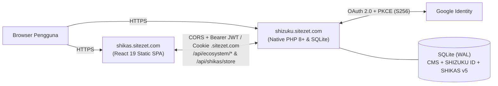

# shizuku (雫) — Native PHP Edition

> **Personal Digital Hub, Portofolio CMS, dan Server Identitas Terpusat (`SHIZUKU ID`) Berbasis Native PHP 8+ & SQLite yang Ringan, Cepat, dan Tanpa Dependensi Eksternal**

[](https://shizuku.sitezet.com)
[](https://shikas.sitezet.com)
[](https://www.php.net/)
[](https://www.sqlite.org/)
[](#%EF%B8%8F-arsitektur--teknologi)
[](#%EF%B8%8F-infrastruktur--spesifikasi-deployment)

**shizuku-php (雫)** adalah pusat digital personal (*personal hub*), portofolio/CV dinamis, sekaligus **server identitas & database terpusat (`SHIZUKU ID`)** untuk seluruh ekosistem aplikasi web **SHIZUKU** (termasuk [**SHIKAS**](https://shikas.sitezet.com) dan aplikasi pendamping berikutnya). Dibangun murni dengan **Native PHP 8.1+ & SQLite** tanpa *framework* berat, tanpa Composer, dan tanpa *runtime* Node.js—sehingga mampu berjalan sangat ringan di *shared hosting* standar (`~10–25 MB RAM` per *request*, `0 MB` saat *idle*) sambil mempertahankan tampilan editorial minimalis, *Admin Studio* 5-tab, **Sign in with Google (OAuth 2.0 + PKCE)**, serta kontrak API v5 yang 100% stabil.

🔗 **Akses Production Live**: [https://shizuku.sitezet.com](https://shizuku.sitezet.com)  
🔗 **Aplikasi Pendamping (SHIKAS)**: [https://shikas.sitezet.com](https://shikas.sitezet.com)

---

## 🌟 Fitur & Modul Utama

1. **Beranda Galeri & Pengalaman Editorial Minimalis (`/`)**
   - Mengusung estetika pastel Jepang yang tenang dengan latar *watercolor* resolusi tinggi, efek rintik hujan (*Shizuku rain layer*) yang halus, dan animasi *splash* sekali per sesi (*sessionStorage guard*).
   - Desain responsif menyeluruh mulai dari layar mobile kompak (`360px` / `390px`) hingga desktop lebar (`1440px+`) dengan *mobile navigation drawer* bergaya minimalis.

2. **Pusat Aplikasi Ekosistem (`/workspace`)**
   - Menampilkan katalog terpusat seluruh aplikasi ekosistem (**SHIZUKU**, **SHIKAS**, **SHIKOST**, dan aplikasi berikutnya) beserta kategori, badge, dan status aktif.
   - Dilengkapi kartu status **SHIZUKU ID** aktif yang menampilkan akun terhubung serta akses cepat ke halaman akun atau aplikasi terkait.

3. **Portofolio CV & Galeri Sertifikat (`/portfolio`)**
   - Menyajikan rekam jejak terstruktur dalam 3 pilar utama: **Education**, **Work**, dan **Organization**.
   - Mendukung **pengelompokan organisasi induk (*parent-organization grouping*)** sehingga beberapa peran dalam satu organisasi tampil rapi dalam satu kartu terpadu.
   - Galeri **Certificates** interaktif dilengkapi *modal lightbox* pratinjau gambar resolusi penuh dan pengaturan urutan tampilan.

4. **Profil Personal & Dwibahasa Instan (`/about` & `EN | ID`)**
   - Halaman narasi personal, fokus keahlian, dan tautan kontak/sosial yang seluruh isinya dikelola melalui database.
   - **Switch Bahasa Instan (`EN | ID`)** dengan *English* sebagai default—mengubah seluruh label UI sekaligus konten dwibahasa dari database secara langsung tanpa *reload*.

5. **Portal Identitas Terpusat — SHIZUKU ID (`/account`)**
   - Satu akun untuk masuk ke seluruh ekosistem **SHIZUKU** (termasuk sinkronisasi data pribadi di **SHIKAS**).
   - Mendukung registrasi & login **Email + Password** (`password_hash` / `bcrypt`) serta **Sign in with Google (OAuth 2.0 + PKCE S256)**.
   - Menampilkan ringkasan jumlah transaksi **SHIKAS** yang tersinkron secara *real-time* serta tombol peluncur langsung ke `https://shikas.sitezet.com`.

6. **Admin Studio CMS 5-Tab (`/admin`)**
   - Panel administrasi *full-CRUD* yang terpisah penuh dari sesi pengguna ekosistem (`shizuku_admin_session` vs `shizuku_eco_session`):
     - **Profile**: Ubah nama brand, biodata dwibahasa (`EN`/`ID`), tautan sosial, dan aset visual utama.
     - **Work**: Tambah, edit, sembunyikan, dan atur urutan kartu aplikasi ekosistem.
     - **Portfolio**: Kelola riwayat Pendidikan, Pekerjaan, dan Organisasi lengkap dengan *chips* pengelompokan organisasi induk.
     - **Certificates**: Unggah gambar sertifikat (validasi *magic bytes* server-side), edit keterangan, dan atur urutan tampil.
     - **Security**: Rotasi kata sandi administrator secara aman langsung dari antarmuka web.

7. **Single Sign-On (SSO) Lintas Subdomain & Bearer Token**
   - Menggunakan token **JWT HS256 (RFC 7519)** buatan murni tanpa pustaka pihak ketiga.
   - Mendukung autentikasi ganda: *HttpOnly Cookie* lintas subdomain (`.sitezet.com`) **dan** header `Authorization: Bearer <token>` (dengan aturan passthrough khusus di `.htaccess` agar tetap bekerja pada Apache CGI/FastCGI).
   - Alur **Google OAuth 2.0 + PKCE** dilengkapi *encrypted state cookie*, daftar origin tepercaya (*anti open-redirect*), serta pengembalian `#shizuku_token=<jwt>` maupun `?oauthError=...` secara presisi ke aplikasi pendamping.

8. **Penyimpanan Cloud Privat SHIKAS (Kontrak API v5)**
   - Menyediakan endpoint `GET/PUT /api/shikas/store` dengan **isolasi ketat per `userId`** (kunci primer komposit `(userId, id)` dan `ON DELETE CASCADE`).
   - Mendukung penuh skema v5 **SHIKAS**: daftar kantong dana (`accountsJson`), tanggal mulai siklus gajian (`cycleStartDay` `1–28`), transaksi `income | expense | transfer`, kantong sumber/tujuan (`accountId`, `toAccountId`), serta biaya admin transfer (`feeIdr`).

9. **Pengerasan Keamanan & Zero-Dependency Media Streaming**
   - Proteksi *Same-Origin CSRF Guard* pada seluruh mutasi `/api/admin/*` dan `/api/auth/*`.
   - Pemblokiran akses web langsung ke `.env`, `src/`, `data/`, dan file `.db` melalui `.htaccess`.
   - Validasi unggahan gambar berbasis *magic bytes* (`finfo` / signature JPEG, PNG, WebP, GIF) dengan proteksi *path traversal* saat melayani `/api/uploads/{filename}`.

---

## 🏗️ Arsitektur & Teknologi



| Komponen | Teknologi | Keterangan |
| :--- | :--- | :--- |
| **Backend & Routing** | [Native PHP 8.1+](https://www.php.net/) | *Single front-controller* (`index.php`), 0 dependensi eksternal |
| **Database** | [SQLite 3](https://www.sqlite.org/) (`PDO_SQLITE`) | Mode `WAL`, migrasi skema & *seeding* otomatis saat start pertama |
| **Autentikasi & SSO** | Custom RFC 7519 HS256 JWT + `password_hash` | Sesi Admin & Ekosistem terpisah, mendukung Cookie & Bearer JWT |
| **OAuth Provider** | Google OAuth 2.0 + PKCE (`S256`) | Menggunakan `cURL` (dengan *fallback* stream context) tanpa SDK eksternal |
| **Frontend & Styling** | Precompiled Tailwind CSS + Vanilla JS | Satu stylesheet ringan `public/css/shizuku.css` (`~11 KB` gzipped) |
| **Web Server** | Apache / LiteSpeed (`.htaccess`) | Rewrite aset statis, proteksi file privat, & passthrough `HTTP_AUTHORIZATION` |

---

## 🔌 Kontrak API Ekosistem (v5)

| Endpoint | Method | Autentikasi | Keterangan |
| :--- | :--- | :--- | :--- |
| `/api/health` | `GET` | Publik | Pemeriksaan kesehatan aplikasi & koneksi SQLite |
| `/api/ecosystem/register` | `POST` | Publik (CORS) | Daftar akun `SHIZUKU ID` baru → `201 { user, token }` |
| `/api/ecosystem/login` | `POST` | Publik (CORS) | Masuk dengan email & password → `200 { user, token }` |
| `/api/ecosystem/logout` | `POST` | Publik (CORS) | Hapus cookie sesi ekosistem → `200 { ok: true }` |
| `/api/ecosystem/me` | `GET` | Cookie / Bearer | Ambil profil sesi aktif `{ user }` atau `{ user: null }` |
| `/api/ecosystem/google` | `GET` | Publik | Mulai login Google OAuth 2.0 + PKCE (`?redirect=...`) |
| `/api/ecosystem/google/callback` | `GET` | OAuth State | Validasi kode Google, terbitkan sesi & redirect + `#shizuku_token` |
| `/api/shikas/store` | `GET` / `PUT` | **Wajib (401)** | Ambil/simpan penuh state **SHIKAS** v5 terisolasi per pengguna |
| `/api/uploads/{filename}` | `GET` | Publik | Streaming aman aset media hasil unggahan Admin Studio |

---

## 🖥️ Infrastruktur & Spesifikasi Deployment

Aplikasi produksi berjalan pada **Shared Hosting (cPanel / Apache)** yang sangat hemat biaya dan bebas perawatan *container*:

- **Alamat Domain Publik**: [https://shizuku.sitezet.com](https://shizuku.sitezet.com)
- **Aplikasi Pendamping Terhubung**: [https://shikas.sitezet.com](https://shikas.sitezet.com)
- **Runtime Server**: PHP 8.1 / 8.2 / 8.3 dengan ekstensi bawaan (`pdo_sqlite`, `curl`, `openssl`, `fileinfo`, `mbstring`)
- **Konsumsi Memori**: `~10–25 MB` RAM saat memproses request, **`0 MB` saat idle** (tanpa proses *background* permanen)
- **Konfigurasi SSO & CORS**:
  - `PUBLIC_BASE_URL="https://shizuku.sitezet.com"`
  - `ECOSYSTEM_ALLOWED_ORIGINS="https://shikas.sitezet.com"`
  - `ECOSYSTEM_COOKIE_DOMAIN=".sitezet.com"`
  - `COOKIE_SECURE="true"` (HTTPS aktif via AutoSSL)
- **Google Cloud Console (Production OAuth)**:
  - *Authorized JavaScript origin*: `https://shizuku.sitezet.com`
  - *Authorized redirect URI*: `https://shizuku.sitezet.com/api/ecosystem/google/callback`

---

## 🚀 Menjalankan Proyek di Lingkungan Lokal (Development)

### Prasyarat
- **PHP 8.1** atau lebih baru (dengan ekstensi `pdo_sqlite`, `curl`, `openssl`, `mbstring` aktif)
- Tidak memerlukan Node.js, npm, Composer, maupun server MySQL/PostgreSQL.

### 1. Klon Repository
```bash
git clone https://github.com/farhansatrian/shizuku-php.git
cd shizuku-php
```

### 2. Konfigurasi Environment Variable
Salin contoh konfigurasi dan sesuaikan untuk lingkungan lokal:
```bash
cp .env.example .env
```

Contoh konfigurasi `.env` untuk *local development*:
```env
APP_ENV="development"
PUBLIC_BASE_URL=""
DATABASE_PATH="data/shizuku.db"
UPLOAD_DIR="data/uploads"
AUTH_SECRET="ganti_dengan_string_acak_minimal_32_karakter"
ADMIN_USERNAME="farhan"
ADMIN_EMAIL="farhansatria.07@gmail.com"
ADMIN_PASSWORD="ganti_dengan_password_kuat"
COOKIE_SECURE="false"
ECOSYSTEM_ALLOWED_ORIGINS="http://localhost:5173,http://127.0.0.1:5173"
ECOSYSTEM_COOKIE_DOMAIN=""
GOOGLE_CLIENT_ID="opsional_client_id_google"
GOOGLE_CLIENT_SECRET="opsional_client_secret_google"
```

> **Tip Lokal**: Kosongkan `PUBLIC_BASE_URL=""` saat pengembangan lokal agar cookie OAuth otomatis menyesuaikan `localhost:8088` atau `127.0.0.1:8088`. Pada server production HTTPS, isi wajib dengan `https://shizuku.sitezet.com`.

### 3. Jalankan Development Server
```bash
php -S 127.0.0.1:8088 index.php
```
Database SQLite (`data/shizuku.db`) dan data awal akan dibuat otomatis pada akses pertama. Buka:
- Situs publik: [http://localhost:8088](http://localhost:8088)
- Admin Studio: [http://localhost:8088/admin](http://localhost:8088/admin)
- Healthcheck API: [http://localhost:8088/api/health](http://localhost:8088/api/health)

---

## 🧪 Verifikasi, Keamanan & Quality Gates

Standar pemeriksaan sebelum setiap rilis atau unggah ke production:

```bash
# 1. Validasi sintaks seluruh file PHP (21 file)
find . -maxdepth 4 -name "*.php" -not -path "./.git/*" -print0 | xargs -0 -n1 php -l

# 2. Verifikasi endpoint kesehatan server
curl -s http://127.0.0.1:8088/api/health
```

### Cek Keamanan & Integritas Terverifikasi:
- **Anti-Tampering JWT**: Penolakan otomatis untuk token kadaluarsa, signature dimodifikasi, maupun algoritma selain `HS256`.
- **Proteksi OAuth Open-Redirect**: Parameter `?redirect=` hanya menerima path internal (`/account`, dst.) atau origin yang terdaftar di `ECOSYSTEM_ALLOWED_ORIGINS`.
- **Isolasi Pengguna SHIKAS**: Pengujian *cross-user* memastikan transaksi dan kantong dana antar `userId` tidak dapat saling membaca atau menimpa.
- **Anti Path-Traversal & Validasi Media**: Hanya file gambar valid (JPEG, PNG, WebP, GIF) dengan nama ter-sanitasi yang dapat diunggah dan disajikan melalui `/api/uploads/`.
- **Uji Integrasi Live Lintas-Origin**: Teruji langsung berpasangan dengan **SHIKAS** (registrasi, kantong dana, transaksi `income/expense/transfer + feeIdr`, siklus gajian `cycleStartDay`, reload persistence, logout/login, serta responsif mobile `360px` & `390px`).

---

## 📦 Cadangan & Pemulihan Data (Backup & Restore)

Seluruh data aplikasi (CMS, akun `SHIZUKU ID`, dan transaksi **SHIKAS**) tersimpan dalam satu file `data/shizuku.db`, sementara aset gambar berada di `data/uploads/`.

> **Catatan Penting SQLite WAL**: Jangan menyalin file `data/shizuku.db` mentah saat server aktif tanpa melakukan *checkpoint* atau `VACUUM INTO`, agar transaksi terbaru di file `-wal` ikut tersimpan utuh.

```bash
# Membuat salinan backup SQLite yang bersih & self-contained (aman saat server aktif)
php -r '
$pdo = new PDO("sqlite:data/shizuku.db");
$pdo->exec("VACUUM INTO \"backup-shizuku-" . date("Ymd-His") . ".db\"");
'

# Arsipkan backup DB beserta folder gambar unggahan
tar czf shizuku-full-backup-$(date +%F).tar.gz backup-shizuku-*.db data/uploads/
```

---

## 📄 Lisensi & Ekosistem

Proyek ini dikembangkan dan dikelola oleh **Farhan Satria Nugraha** sebagai pusat dari ekosistem web personal **SHIZUKU (雫)**:

- **SHIZUKU Hub (Live)**: [https://shizuku.sitezet.com](https://shizuku.sitezet.com) · [`farhansatrian/shizuku-php`](https://github.com/farhansatrian/shizuku-php)
- **SHIKAS Cashflow (Live)**: [https://shikas.sitezet.com](https://shikas.sitezet.com) · [`farhansatrian/shikas`](https://github.com/farhansatrian/shikas)
- **KostKas / SHIKOST**: [`farhansatrian/kostkas`](https://github.com/farhansatrian/kostkas)
